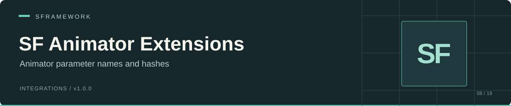

# SF Animator Extensions

[Documentation website](https://docs.secretplace.studio/#sf-extensions-animator)

An Inspector dropdown for Animator parameter names and hashes. Add `[SFAnimatorParameter]` to a serialized string or integer field, identify a serialized Animator field on the same object, and choose a parameter from its controller.

Package: `sp.sframework.extensions.animator` · Version: `1.0.0` · [MIT license](LICENSE.md)

## Install

In Unity's Package Manager, choose **Add package from git URL** and enter:

```text
https://github.com/huran438/sf-extensions-animator.git#master
```

The runtime assembly has no package assembly references. The editor assembly references `SFramework.Animator.Runtime` and uses Unity's editor APIs. No SF Core dependency appears in the source or assembly definitions.

For your own assembly definition, reference `SFramework.Animator.Runtime`. The C# namespace is **`_Client_.AnimatorExtensions.Runtime`**, despite the `SFramework.Animator.Runtime` assembly name.

The manifest specifies no Unity version. This README reflects static source inspection; the drawer and example have not been run in Unity.

## Example

Save this as `AnimatorParametersExample.cs` and attach it to a GameObject:

```csharp
using _Client_.AnimatorExtensions.Runtime;
using UnityEngine;

public sealed class AnimatorParametersExample : MonoBehaviour
{
    [SerializeField] private Animator _animator;

    [SerializeField]
    [SFAnimatorParameter(nameof(_animator), AnimatorControllerParameterType.Float)]
    private int _speedHash;

    [SerializeField]
    [SFAnimatorParameter(nameof(_animator), AnimatorControllerParameterType.Trigger)]
    private string _jumpName = string.Empty;

    public void SetSpeed(float value)
    {
        if (_animator != null && _speedHash != 0)
            _animator.SetFloat(_speedHash, value);
    }

    public void Jump()
    {
        if (_animator != null && !string.IsNullOrEmpty(_jumpName))
            _animator.SetTrigger(_jumpName);
    }
}
```

Assign an Animator that uses an Animator Controller containing a float parameter and a trigger parameter. Select each one in the component's Inspector. An integer field stores the selected parameter's `nameHash`; a string field stores its `name`.

The attribute only configures the editor field. Your gameplay code decides when to call Animator methods, as the example's public methods do.

## API

| API | Behavior |
| --- | --- |
| `SFAnimatorParameterAttribute(string animatorName)` | Lists parameters of all types from the referenced Animator |
| `SFAnimatorParameterAttribute(string animatorName, AnimatorControllerParameterType animatorParamType)` | Lists parameters matching the requested type |
| `AnimatorName` | Serialized Animator field name supplied to the constructor |
| `AnimatorParamType` | Optional parameter type filter; `null` means all types |
| Integer target field | Stores `AnimatorControllerParameter.nameHash`; **None** stores `0` |
| String target field | Stores `AnimatorControllerParameter.name`; **None** assigns `null` through the serialized property |

## Limits and troubleshooting

- Use the exact serialized field name for `animatorName`. The drawer looks for it at the serialized object's root, then under a root field named `_value`; it does not search arbitrary nested objects.
- The referenced field must contain an `Animator`. An Animator Controller asset or GameObject reference does not satisfy the lookup.
- A missing or empty Animator reference produces **Target animator controller is null**. A missing root field can also throw in the fallback lookup when the object has no `_value` field, so use a valid field name.
- Apply the attribute to a string or integer field. Other property types produce an Inspector warning.
- A stored value that no longer matches a parameter displays **None**. The string drawer writes that empty selection while drawing; the integer drawer changes its value only after a selection change. Recheck selections after renaming parameters or changing controllers.
- The package does not change controllers, drive animation, or validate parameter calls at runtime. Keep runtime guards and controller assumptions in your own code.

## Source

- [Runtime attribute](Runtime/SFAnimatorParameterAttribute.cs)
- [Inspector drawer](Editor/SFAnimatorParameterAttributeDrawer.cs)
- [Runtime assembly](Runtime/SFramework.Animator.Runtime.asmdef) and [editor assembly](Editor/SFramework.Animator.Editor.asmdef)
- [Package manifest](package.json)

Source snapshot: [`692db385e2e84d3e70f0342284c9dfd56837b83e`](https://github.com/huran438/sf-extensions-animator/commit/692db385e2e84d3e70f0342284c9dfd56837b83e) (`master`). Example validation: static API review only; no compilation or execution in Unity.
