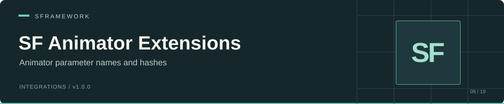

# SF Animator Extensions

 

## Overview

SF Animator Extensions adds an Inspector dropdown for Animator parameter names and hashes. Apply `[SFAnimatorParameter]` to a serialized string or integer field and select a parameter from an Animator on the same serialized object.

## Requirements

- `SFramework.Animator.Runtime` has no package assembly references. `SFramework.Animator.Editor` is Editor-only and references the runtime assembly plus Unity editor APIs. SF Core is not required.
- [package.json](package.json) declares no dependencies or minimum Unity version; check compatibility with your editor.
- Application assemblies must reference `SFramework.Animator.Runtime`. Its C# namespace is `_Client_.AnimatorExtensions.Runtime`; editor types use `_Client_.AnimatorExtensions.Editor`.

## Installation

In Unity Package Manager, choose **Add package from git URL**:

```text
https://github.com/huran438/sf-extensions-animator.git#master
```

Or add this entry to `dependencies` in the host project's `Packages/manifest.json`:

```json
"sp.sframework.extensions.animator": "https://github.com/huran438/sf-extensions-animator.git#master"
```

Use a commit hash instead of `master` to pin a revision.

## Quick start

Create `AnimatorParametersExample.cs` and attach it to a GameObject:

```csharp
using _Client_.AnimatorExtensions.Runtime;
using UnityEngine;

public sealed class AnimatorParametersExample : MonoBehaviour
{
    [SerializeField] private Animator _animator;

    [SerializeField]
    [SFAnimatorParameter(nameof(_animator), AnimatorControllerParameterType.Float)]
    private int _speedHash;

    [SerializeField]
    [SFAnimatorParameter(nameof(_animator), AnimatorControllerParameterType.Trigger)]
    private string _jumpName = string.Empty;

    public void SetSpeed(float value)
    {
        if (_animator != null && _speedHash != 0)
            _animator.SetFloat(_speedHash, value);
    }

    public void Jump()
    {
        if (_animator != null && !string.IsNullOrEmpty(_jumpName))
            _animator.SetTrigger(_jumpName);
    }
}
```

Assign an Animator with a controller containing a Float and a Trigger parameter. Choose them in the component's Inspector. Integer fields store `nameHash`; string fields store the parameter name. The attribute configures selection only; your code decides when to invoke Animator methods.

## API

| API | Purpose |
| --- | --- |
| `SFAnimatorParameterAttribute(string animatorName)` | List all parameter types from the referenced serialized Animator field. |
| `SFAnimatorParameterAttribute(string animatorName, AnimatorControllerParameterType)` | Filter by parameter type. |
| `AnimatorName` | Serialized Animator field name passed to the constructor. |
| `AnimatorParamType` | Optional type filter; null means all types. |
| Integer target | Store parameter `nameHash`; **None** stores `0`. |
| String target | Store parameter `name`; **None** stores an empty string. |

## Behavior and limitations

- Use an exact serialized Animator field name. The drawer checks the serialized object's root and its root `_value` field.
- Assign an Animator with a controller. When editing multiple objects, the dropdown is available when the selected objects reference the same Animator.
- Apply the attribute to string or integer fields. Other types display an Inspector warning.
- An unavailable name or hash appears as **Missing** with its stored value. Select a replacement or **None** to change it.
- The package neither drives animation nor validates Animator calls at runtime. Maintain controller assumptions and runtime guards in your application.

## Tests

Package tests are in [Tests/Editor](Tests/Editor), in assembly `SFramework.Animator.Editor.Tests`. Install Unity Test Framework and add this package ID to the **top-level** `testables` array in the host project's `Packages/manifest.json`, preserving existing entries:

```json
"testables": ["sp.sframework.extensions.animator"]
```

Open **Window > General > Test Runner**, choose **EditMode**, and run the package tests with the requirements above installed. The local `sf-demo` host enables all SFramework package tests. Test assemblies are included under `UNITY_INCLUDE_TESTS`.

## License

MIT. See [LICENSE.md](LICENSE.md).
